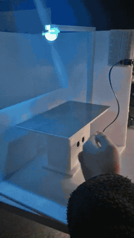
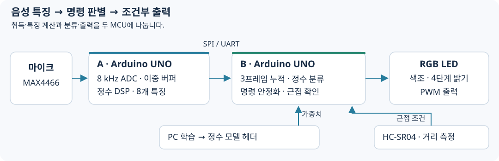

# 음성으로 색조·밝기를 바꾸는 조명

마이크 입력부터 신호 처리, 명령 분류, 실제 출력까지 두 대의 Arduino UNO로 구현한 비접촉 조명 제어 시제품입니다. 음성 명령이 안정적으로 인식되고 사용자가 가까이 있을 때 RGB LED의 상태를 바꿉니다.

**ATmega328P · C/C++ · ADC/Timer ISR · 정수 DSP·추론 · SPI/UART · PWM**

## 시연

[전체 시연영상](media/demo.mp4) · [확인할 구간](docs/demo.md)

음성에 따른 색조·밝기 변화와 근접 조건을 확인할 수 있습니다. RGB LED를 사용하는 교육용 시제품입니다.

## 전체 흐름

A보드는 음성 특징을 만들고, B보드는 명령을 판별해 출력합니다. PC는 모델 학습에 사용하며, 장치의 추론은 MCU에서 수행합니다. Warm/Cool은 색조, Low/High는 4단계 밝기를 조절하고 Silence는 명령으로 실행하지 않습니다.

## 주요 구현

**1. 샘플 취득과 계산 분리**

8 kHz ADC로 160샘플을 모아 20 ms 프레임을 만듭니다. ISR은 샘플 저장·버퍼 교대를 맡고, 메인 루프에서 필터와 특징을 계산해 다음 프레임 취득과 겹치도록 했습니다.

**2. 작은 MCU에서의 정수 추론**

RMS·Vpp·ZCR·Goertzel 특징을 세 프레임 누적해 24차원 입력으로 구성합니다. PC에서 학습한 선형 모델을 정수 파라미터로 내보내고, MCU에서 표준화와 클래스 점수 계산을 수행합니다.

**3. 분류 결과를 출력 조건과 연결**

두 링크에 같은 패킷·체크섬을 사용하고 SPI 연속 실패 시 UART로 전환합니다. 무음 gate·투표·연속 확인·불응기로 명령을 안정화하고, Timer1 입력 캡처로 측정한 근접 조건을 함께 적용합니다.

## 결과와 확인 범위

보고서에는 색조·밝기 제어와 통신선 단선·복구 시험이 기록되어 있습니다. 오실로스코프로 측정한 프레임 처리·추론 구간은 시스템 전체의 명령 반영 지연과 구분합니다. 수치와 시험 조건은 [결과 문서](docs/results.md)에 모았습니다.

공개 소스는 Timer1 입력 캡처가 포함된 A/B sketch와 모델·학습 도구입니다. 특징 배열 순서와 PC/MCU 파라미터의 대응 등 재현 전에 확인할 항목은 [실행 준비](docs/reproduction.md)에 명시했습니다.

## 문서와 코드

| 살펴볼 내용 | 링크 |
|---|---|
| 보드 경계·패킷·후처리 | [시스템 구조](docs/architecture.md) |
| 설계 선택과 문제 해결 | [개발 과정](docs/development.md) |
| 시험 조건·계측 | [결과](docs/results.md) |
| 원본 파일·버전 안내 | [코드 안내](docs/code-map.md) |
| 배선·모델·실행 조건 | [실행 준비](docs/reproduction.md) |
| ADC·특징·전송 | [A보드 코드](firmware/A_wclh_5/A_wclh_5.ino) |
| 수신·분류·출력 | [B보드 코드](firmware/B_wclh_5/B_wclh_5.ino) |
| 모델 학습·정수 파라미터 생성 | [PC 학습 도구](tools/prep_train_export_wclh_k5.py) |

---

[대표 프로젝트 모아보기](https://github.com/jounget5411-lab/portfolio)
